# LotteryClock

[](https://www.lotteryclock.app)
[](LICENSE)
[](https://kiro.dev)
[](https://kiroween.devpost.com/)
[](https://developer.apple.com/videos/play/wwdc2025/230/)

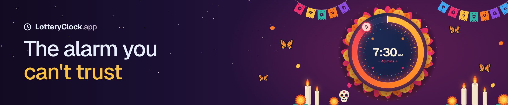

An alarm clock that gambles with your morning.

You pick a wake-up time and add some doubt. The alarm rings at a random moment inside that window, before or after your target time. You never know which.

**Try it:** [lotteryclock.app](https://www.lotteryclock.app) · Built for [Kiroween](https://kiroween.devpost.com/), in the Resurrection and Costume Contest tracks.

## Origin

**Early 2000s.** I tripped over my alarm clock while cleaning and unplugged it. Later I plugged it back in without knowing how long it had been off. I was always late for school and always hit snooze.

The next morning, just before I hit snooze, I stopped and wondered whether the time was right. Had it been unplugged for 5 minutes or 20? Was I late?

Not knowing got me out of bed. I was on time that day and the next few, until I worked out the offset and reset the clock.

**2012.** I built a first iPhone version designed like a slot machine. It never launched.

**Now.** This is a rebuild for the Kiroween hackathon, "Resurrection" category: an old idea brought back with current tech.

## How it works

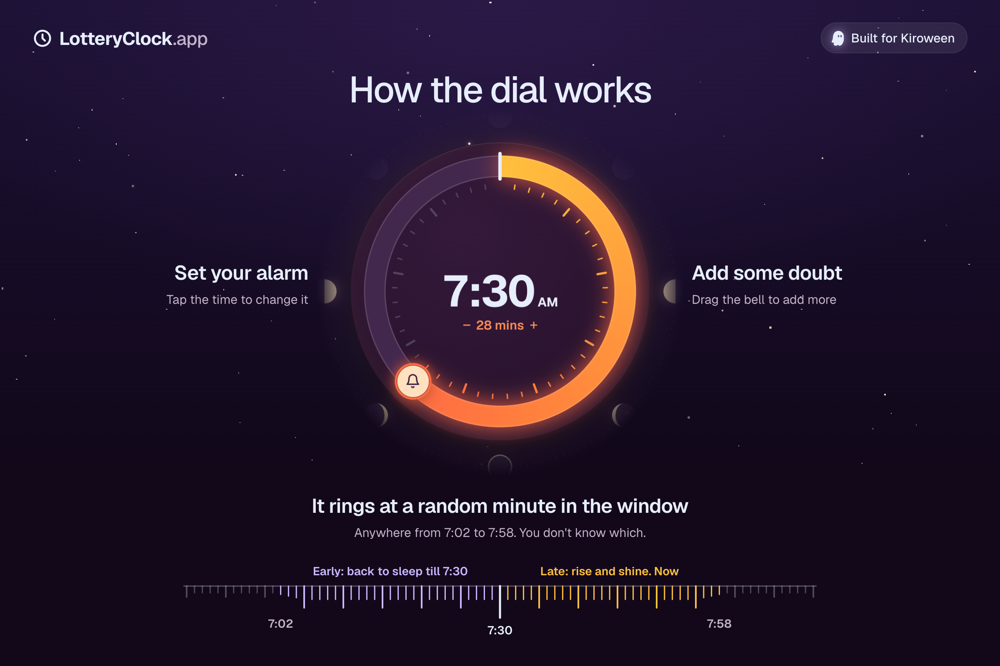

1. Set your alarm. Tap the time in the middle of the dial to change your target, for example 7:30.
2. Add some doubt. Drag the bell round the dial to set how far either side of the target the alarm can ring. One full turn is 45 minutes.
3. Tap Set Alarm. The app picks a random offset inside that window and schedules the alarm at target + offset. The offset stays hidden.

| Alarm rings | Result |
|---|---|
| Before target (for example 14 min early) | You win. You can snooze, and the snooze ends exactly at the target time, so you earned 14 minutes of sleep. |
| After target (for example 14 min late) | You lose. No snooze. You're late and should get up now. |

The uncertainty is the point. Because you can't tell whether you're early or late, you tend to get up instead of snoozing.

The dial is split into six tiers (none, 1 to 11, 12 to 23, 24 to 35, 36 to 44, and the full 45), and each theme names them in its own words. In Good Night they run from "Lights out" to "Full moon madness". The tick climbs in pitch as the doubt grows, and the scene behind the dial changes at every tier.

## The costumes

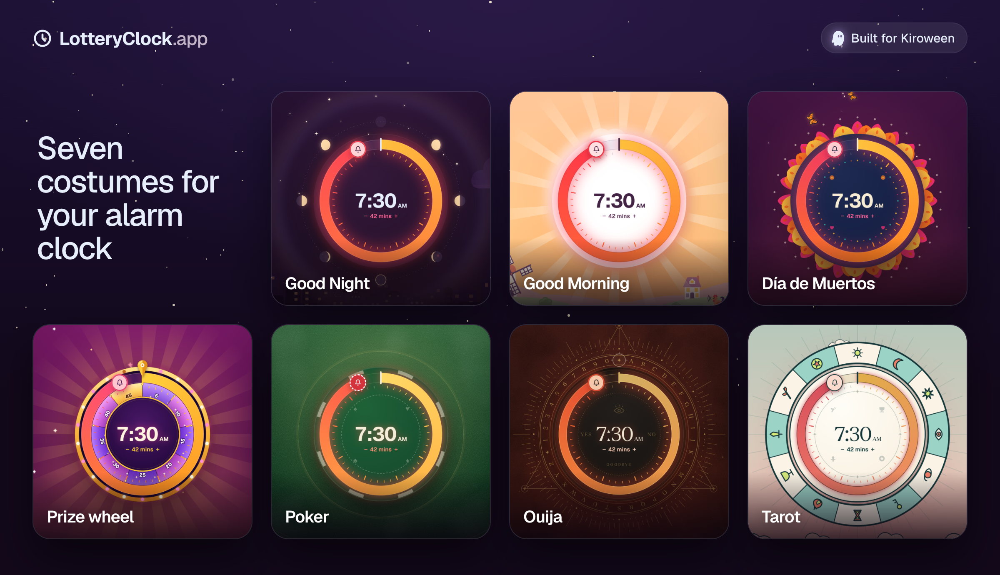

The same dial and the same alarm come in seven looks: Good Morning, Good Night, Día de Muertos, Prize wheel, Poker, Ouija and Tarot. Each one has its own scene, dial ornament, wording and sounds, and reacts in its own way when the alarm rings early or late.

- **Good Morning** is a sunrise over a village that wakes up as the doubt grows, until the rooster crows at 45.
- **Good Night** is a city that gets more restless. A snooze puts it back to bed, and a late alarm brings the dawn up.
- **Día de Muertos** turns the dial into a sugar skull ringed with marigolds, with candles lighting on the ofrenda.
- **Prize wheel** makes the dial the wheel. A late alarm is "Bankrupt".
- **Poker** makes the dial a chip on green felt. A snooze bursts the pot back at you, and a late alarm deals you 7-2 offsuit.
- **Ouija** puts a letter ring round the dial, and the planchette spells HUSH, SOON, WAKE UP, then NO REST.
- **Tarot** turns the tiers into cards, from Temperance to The Tower to The Fool at 45.

Here is every theme in the iPhone app at 22 and 42 minutes of doubt. The scene and the tier name change as the doubt grows.

| Theme | 22 min | 42 min |
|---|:---:|:---:|
| **Good Morning** | 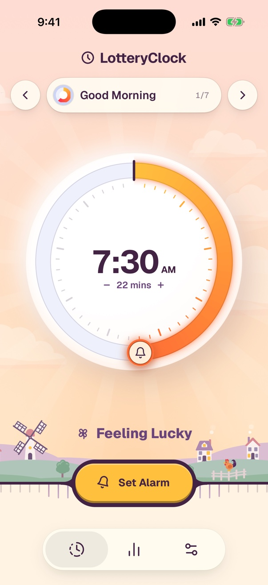 | 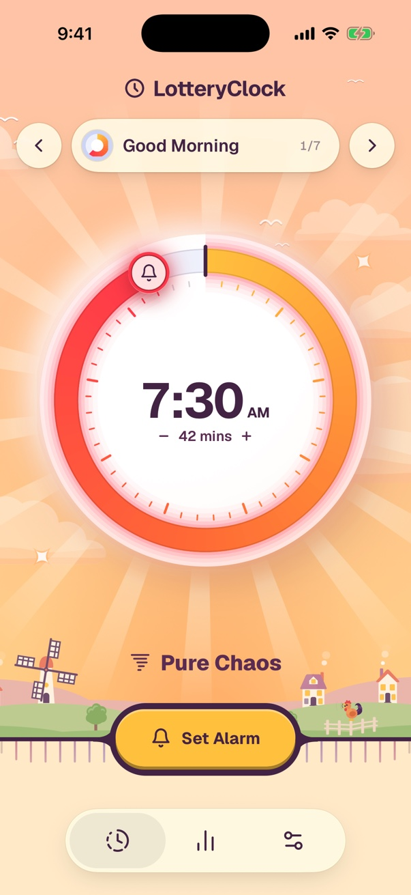 |
| **Good Night** | 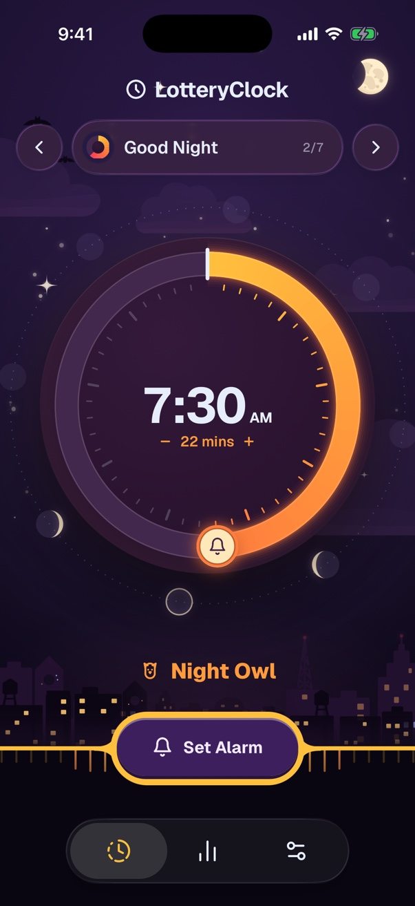 | 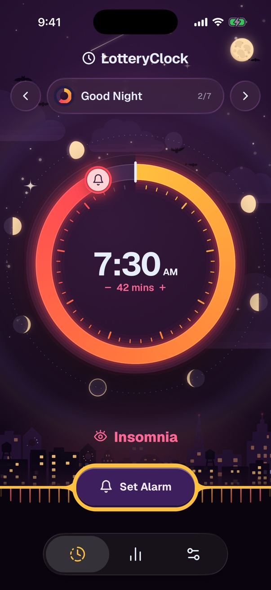 |
| **Día de Muertos** | 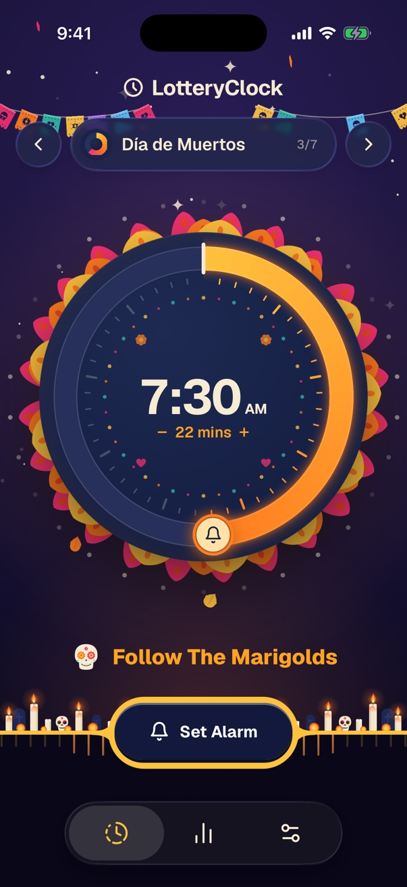 | 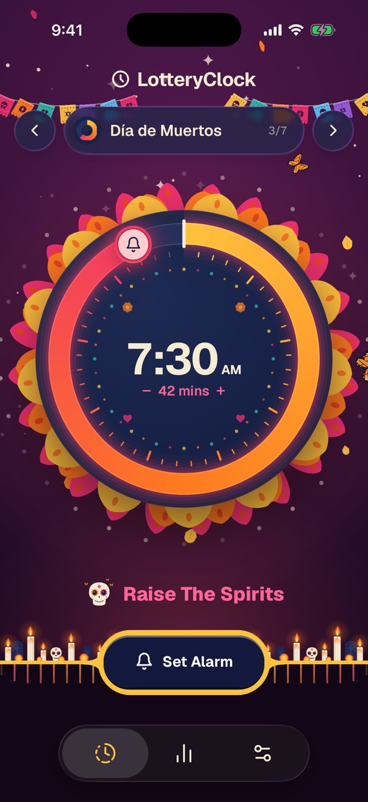 |
| **Prize wheel** | 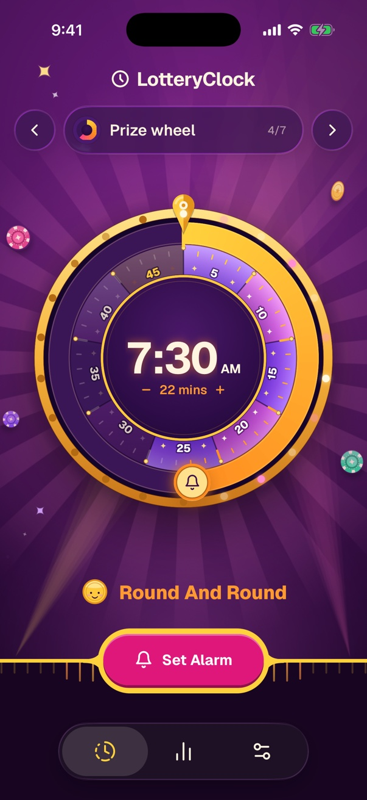 | 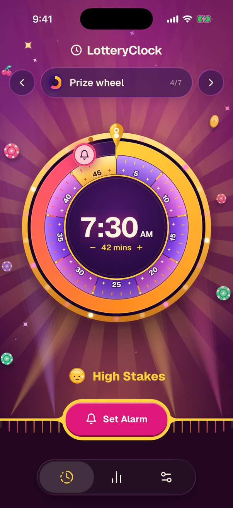 |
| **Poker** | 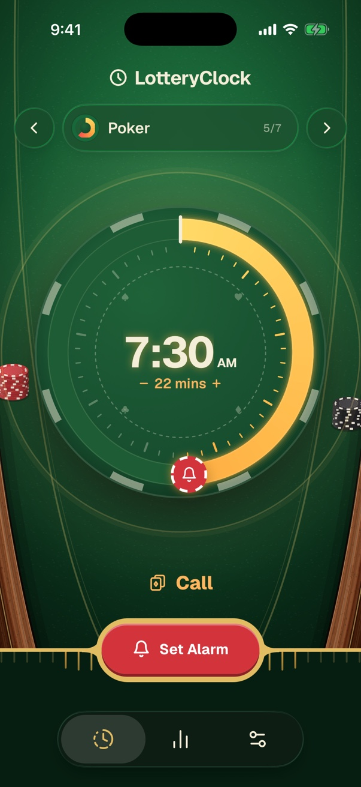 | 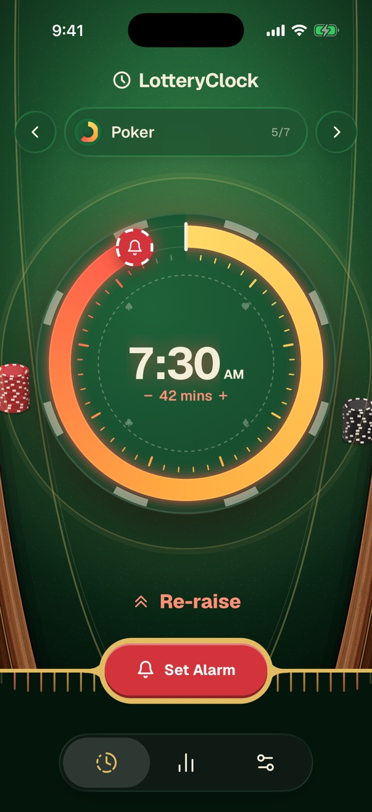 |
| **Ouija** | 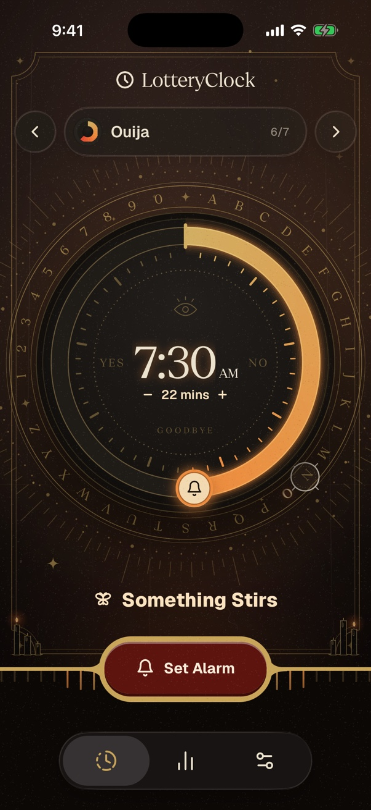 | 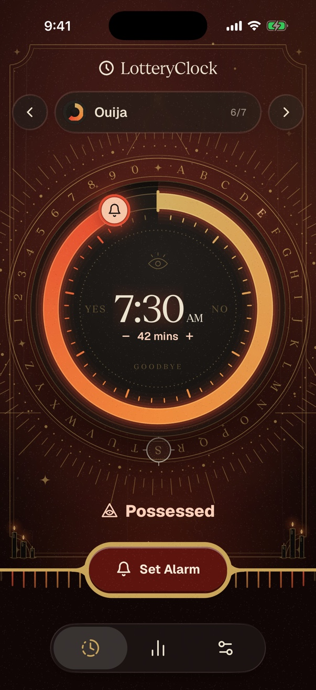 |
| **Tarot** | 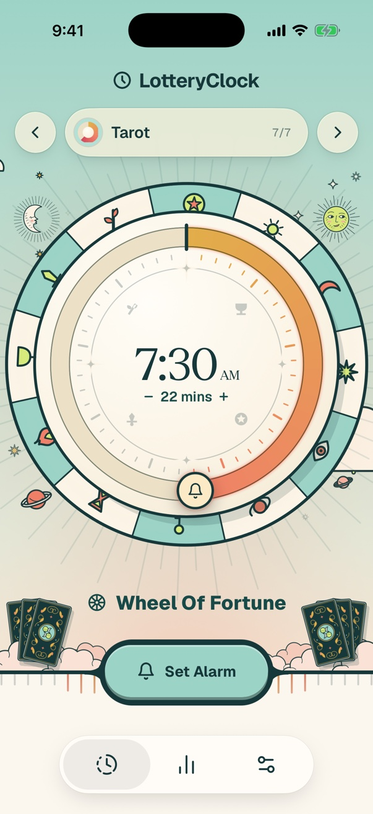 | 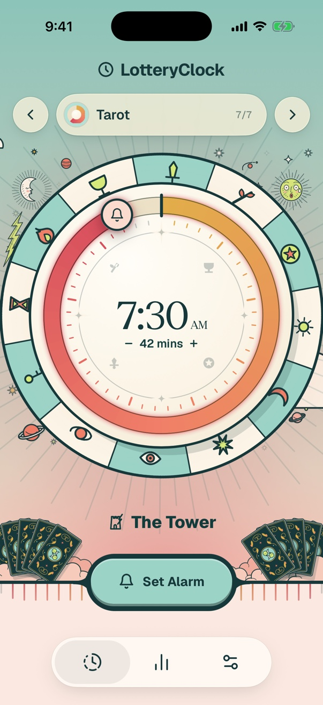 |

## The iPhone app

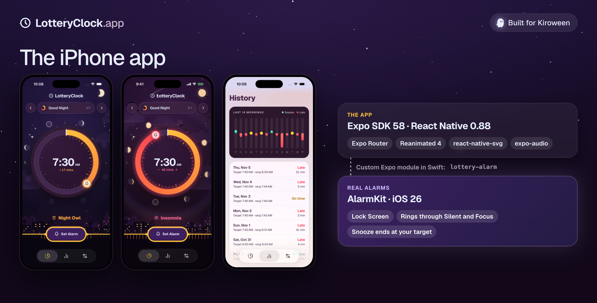

The website is the toy. The iPhone app sets real alarms with Apple's AlarmKit (new in iOS 26), so they show up on the Lock Screen and ring through Silent mode and Focus. An early alarm gets a snooze that ends at your target. A late one gets no snooze button at all.

## How it's built

- **Website** (`web/`): Next.js 16, React 19, Tailwind 4 and Motion. Every costume was designed here first. The short UI sounds, like the dial tick, are synthesized with Web Audio so they can follow the dial.
- **Art**: a prompt doc per theme (in `docs/`) describes the scene tier by tier. The SVGs were generated with OpenAI's GPT image model, cleaned up and inlined as React, so the dial can recolour and animate them. The longer musical sounds came from Suno.
- **iPhone app** (`mobile/`): Expo SDK 58, React Native 0.88, Expo Router, Reanimated 4 and react-native-svg. Two scripts copy the web themes and art into the app, and each scene is redrawn natively.
- **Real alarms**: a small Expo module in Swift (`mobile/modules/lottery-alarm`) that talks to AlarmKit.
- **Tools**: designed and written in the Kiro IDE, mainly with Opus 5.5.

## What's next

- Ship the iPhone app on the App Store, where the 2012 version never made it.
- An Android version.
- A physical LotteryClock built on a Raspberry Pi, so it's a real bedside alarm clock again.

## Running the app

There are two apps: the website (`web/`) and the iPhone app (`mobile/`).

### Website

Needs Node 20.9 or later.

```bash
cd web
npm install
npm run dev
```

Then open http://localhost:3000.

### iPhone app

You need:

- a Mac with Xcode 26 or later, with the iOS Simulator installed;
- Node 22.13 or later;
- CocoaPods (`brew install cocoapods`).

Real alarms use Apple's AlarmKit (iOS 26), so the app needs a development build. It won't run in Expo Go.

#### In the simulator

```bash
cd mobile
npm install
npx expo run:ios
```

The first build takes a few minutes. It creates the `ios/` folder, builds the app, installs it in the simulator and starts Metro (the JavaScript server). After that, if the app is already installed, `npx expo start` is enough.

#### On your iPhone

1. Turn on Developer Mode on the phone (Settings → Privacy & Security → Developer Mode) and connect it to the Mac with a cable.
2. In Xcode, sign in with your Apple Account (Xcode → Settings → Accounts). A free account works.
3. If you're not the original developer, change `ios.bundleIdentifier` in `mobile/app.json` to an ID of your own, for example `com.yourname.lotteryclock`.
4. Build and install:

   ```bash
   cd mobile
   npx expo run:ios --device
   ```

   Pick your phone from the list. The first time, Xcode may ask you to choose a signing team. Open `mobile/ios/LotteryClock.xcworkspace`, select the LotteryClock target, choose your team under Signing & Capabilities, then run the command again.

5. To run the app without the Mac (no Metro), build the Release version instead:

   ```bash
   npx expo run:ios --device --configuration Release
   ```

   The JavaScript is bundled into the app, so it keeps working after you unplug the phone.

The phone must be unlocked when the install finishes, or the app installs but doesn't open. If that happens, open it from the home screen.

#### If the build fails

- **CocoaPods fails with an encoding error:** run `export LANG=en_US.UTF-8` first.
- **"Sandbox: node deny file-read-data" in a Release build:** in Xcode, select the LotteryClock target, open Build Settings, and set **User Script Sandboxing** to **No**. Then build again.
- **"No device matching" your phone's name:** names with a curly apostrophe (such as "Dylan’s iPhone") don't match when typed. Use the phone's ID instead. `xcrun xctrace list devices` shows it in brackets after the iOS version, for example `00008150-…`. Then run `npx expo run:ios --device <id>`.
- **"database is locked":** another build is already running. Wait for it to finish, or close Xcode, and try again.

#### Trying an alarm

You don't have to wait until morning. Open Settings → Developer → "Real alarm in ~1 min" (or "Early ring + snooze") to schedule a real alarm about a minute out. See [mobile/README.md](mobile/README.md) for how the app plays and how the code is organised.

## Repo layout

- `web/` Next.js website, and the source of every theme
- `mobile/` Expo / React Native iPhone app (see `mobile/README.md`)
- `docs/` research, design notes and the art and sound prompts

## Docs

- [Feasibility research: Expo / React Native vs SwiftUI](docs/feasibility.md)
- [Porting a web theme to the app](mobile/docs/porting-scenes.md)

## License

[MIT](LICENSE). The Expo template files in `mobile/` keep their own [MIT license](mobile/LICENSE).
